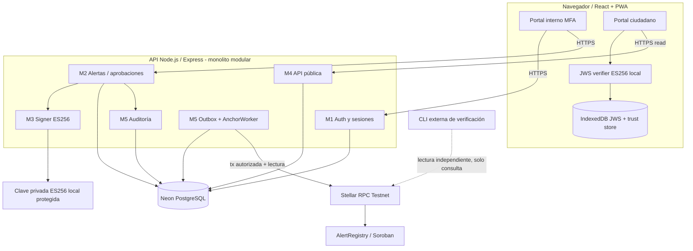
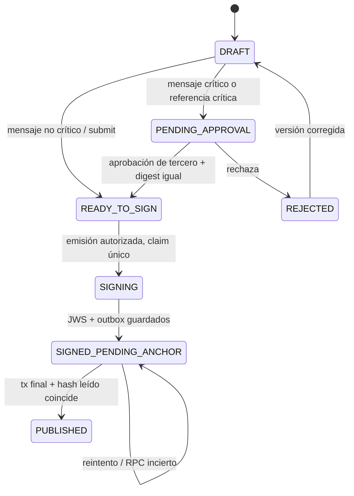

# SIGA-E — Arquitectura técnica definitiva de referencia (v1.2)

**Fecha:** 08/10/2026 · **Raíz del repositorio:** `REPOSITORY_ROOT` · **Estado:** arquitectura de referencia; estado HTTP M2 actualizado al 02/11/2026.
**Fuente de requisitos:** `SIGA-E_Proyecto_Consolidado_v1.2.md`, que integra proyecto 1.1 y adenda E1.2.  
**Enmienda de alcance M1:** `docs/enmiendas/ENM-001-canal-invitaciones-presenciales-M1.md` (12/10/2026) exige QR presencial solo para invitaciones internas; el QR ciudadano M4 continúa diferible.
**Nota de vigencia del MVP (15/10/2026):** [ENM-002](../enmiendas/ENM-002-reduccion-alcance-MVP-4-semanas.md) exige un flujo `Alert` `Severe`, tres roles con MFA, una clave ES256 inicial, outbox mínimo y publicación solo tras relectura coincidente. La CLI restringida de cuentas se limita a PostgreSQL local aislado y sigue pendiente de implementación/pruebas; no autoriza Neon ni activa cuentas sin TOTP. `Update`/`Cancel`, historial sincronizado, invitaciones QR, rotación automática, HSM/KMS y mantenimiento TTL autónomo quedan diferidos para el cierre. PS1–PS6 y PB1–PB4 siguen obligatorios con evidencias reproducibles; las cuotas y MT1–MT13 de v1.2 no son un paquete obligatorio del MVP. Los detalles de diseño no desplazados permanecen vigentes.
**Alcance cerrado:** 6 módulos M1–M6; Neon PostgreSQL; PWA; JWS ES256; **Stellar Testnet y Soroban obligatorios**.  
**Límites de estado:** el árbol backend local implementa las rutas M2 de
creación, listado, detalle, edición, `submit`, `approve` y `reject`. Las pruebas
HTTP usan un servicio simulado; las pruebas PostgreSQL M2 ejercitan el servicio
directamente. No se ha acreditado la ruta Express→Prisma→PostgreSQL ni la
disponibilidad de un servidor desplegado. El flujo de emisión M3 existe en el
servicio backend y ahora tiene una prueba offline de aprobación congelada a
JWS verificado con criptografía real y persistencia simulada. No acredita
PostgreSQL real ni la disponibilidad operativa del firmador local DPAPI; el
anclaje y la publicación siguen pendientes. `Update`/`Cancel` permanecen
diferidos según ENM-002.
La cadena histórica completa de auditoría no está verificada. Este estado no
afirma integración del frontend, contrato Soroban desplegado ni `contract_id`
real.

> **Invariante del sistema:** una alerta nueva no se marca `PUBLISHED` ni se expone en el catálogo público hasta que el backend haya comprobado la firma JWS y confirmado mediante lectura del contrato **confiable** que `message_key` corresponde a `jws_hash`. Un historial publicado anteriormente puede pasar a evidencia `UNVERIFIABLE` si Testnet pierde su estado; nunca se mantiene el sello «registrado ahora» sin comprobación.

**Contrato M2:** [ADR-007](../adr/ADR-007-contrato-documental-m2.md) complementa ADR-006 en lectura de borradores, ETag/If-Match, decisiones vinculadas a digest, corrección y conservación de decisiones. El estado actual del código y el alcance de sus pruebas se registran arriba; esta documentación no acredita despliegue ni integración HTTP con PostgreSQL.

## 1. Registro de decisiones arquitectónicas (ADR)

| ADR | Decisión | Consecuencia |
|---|---|---|
| ADR-01 | Un monorepo pnpm; backend monolítico modular; web React/PWA separada. | Sin microservicios, menor carga operativa. |
| ADR-02 | Neon PostgreSQL + Prisma; acceso solo API. | Migrations versionadas; no exponer `DATABASE_URL`. |
| ADR-03 | JWS compacto ES256 como firma primaria, nunca blockchain en su lugar. | Verificador local usando claves públicas de confianza. |
| ADR-04 | `AlertRegistry` Soroban en **Stellar Testnet**, requisito de publicación. | Contrato Rust + cuenta Stellar administrativa distinta de la JWS. |
| ADR-05 | JWS inmutable, outbox en BD, worker con reconciliación. | Evita fingir ACID entre Neon y Testnet. |
| ADR-06 | Contrato con `__constructor(admin)` y autorización `admin.require_auth()` en escritura. | Cierra inicialización tardía; no permite sobrescritura. |
| ADR-07 | Tres resultados UI: firma / vigencia / anclaje. | Offline solo permite prueba local con estado potencialmente desactualizado. |
| ADR-08 | Signer local restringido como MVP; Azure Key Vault diferido. | Evitar prometer HSM; mantener interfaz intercambiable. |
| ADR-09 | API same-origin HTTPS `/api/v1`; sesiones opacas revocables; CSRF. | No JWT persistente en localStorage ni CORS amplio. |
| ADR-10 | Estado histórico de publicación distinto de vigencia de prueba en Testnet. | Reset/TTL no reescribe historia, pero degrada evidencia. |

## 2. Diagrama de contenedores



Para el MVP, la PWA no consulta Soroban: verifica ES256, política, catálogo confiable y vigencia localmente y muestra blockchain `NO_COMPROBABLE`, incluso si la API entrega metadatos. La CLI externa independiente lee el contrato/red/generación desde configuración confiable, no desde el JWS ni solo desde metadatos de la API. Solo una lectura confiable y conclusiva permite `COINCIDE`, `NO_COINCIDE` o `NO_REGISTRADA`; fallo RPC, TTL, archivo o reset implican `NO_COMPROBABLE`. El navegador no maneja claves privadas.

## 3. Estructura de repositorio que deberá crear Codex posteriormente

```text
REPOSITORY_ROOT\
├─ apps/
│  ├─ web/                        # React + Vite + TypeScript + PWA
│  │  └─ src/
│  │     ├─ app/                    # rutas, layouts, providers
│  │     ├─ features/auth/
│  │     ├─ features/authoring/
│  │     ├─ features/approvals/
│  │     ├─ features/admin/
│  │     ├─ features/public-alerts/
│  │     ├─ features/chain-evidence/
│  │     └─ offline/                # IndexedDB / service worker
│  └─ api/
│     ├─ prisma/                   # schema.prisma + migrations
│     └─ src/
│        ├─ modules/identity/      # M1
│        ├─ modules/alerts/        # M2
│        ├─ modules/signing/       # M3
│        ├─ modules/public/        # M4 endpoints
│        ├─ modules/audit/         # M5
│        ├─ modules/anchoring/     # M5 adaptador Stellar + worker
│        └─ shared/                # validación, errores, config
├─ contracts/
│  └─ alert-registry/              # cargo workspace Rust / Soroban SDK
├─ packages/
│  ├─ api-contracts/               # DTO Zod compartidos sin secretos
│  └─ verify/                      # JWS, confianza, SHA-256 para web
├─ tests/
│  ├─ security/                    # PS1–PS6
│  ├─ blockchain/                  # PB1–PB4
│  └─ e2e/                         # MFA y flujo ciudadano
├─ docs/
│  ├─ proyecto/
│  ├─ arquitectura/
│  ├─ adr/
│  └─ evidencias/                 # capturas sin secretos
├─ scripts/                      # despliegue/testnet/bootstrap/reconcile
├─ .github/workflows/
├─ AGENTS.md                      # se creará en una etapa posterior
├─ .env.example                   # solo nombres, nunca secretos
├─ pnpm-workspace.yaml
├─ package.json
├─ .gitignore
└─ README.md
```

`M6` corresponde a pruebas y scripts; no es un servicio HTTP. `apps/web` **no** importa código de firma, ORM, credenciales ni `stellar secret seed`.

## 4. Dependencias por capas

- **HTTP/presentación:** Express routers, middleware sesión+CSRF+RBAC, validación Zod y Problem Details `application/problem+json` (RFC 9457).
- **Aplicación:** casos de uso `SubmitAlert`, `ApproveAlert`, `IssueAlert`, `ReconcileAnchor`, `RevokeSession`, `VerifyAuditChain`.
- **Dominio:** invariantes de roles, severidad, payload congelado, identidad de alertas, clasificación y estado.
- **Infraestructura:** repositorios Prisma, Neon, signer local, cifrado TOTP, cliente RPC Stellar, outbox worker y logging.

Interfaz `AlertSigner.signJws(protectedHeader, payloadBytes)` devuelve JWS compacto y `kid`, y no expone API de firmar arbitrariamente al usuario. Interfaz `AnchorGateway.read(messageKey, deployment)` devuelve `FOUND(hash)|NOT_FOUND|UNAVAILABLE`; `submit(key, hash, deployment)` se ejecuta únicamente desde worker con material de cuenta protegido.

El procedimiento excepcional `apps/api/scripts/reconcile-submitted-testnet-once.ts` es una composición independiente y solo de lectura RPC: acepta el UUID fijado del trabajo `SUBMITTED`, valida que conserve el hash de transacción aprobado, consulta `getTransaction` y `get_alert` del deployment confiable y reutiliza la validación criptográfica y la transición transaccional del worker. No importa ni crea signer, submitter o worker; cualquier resultado distinto a `SUCCESS` + ledger positivo + lectura coincidente deja el trabajo sin publicar. Su concesión de escritura PostgreSQL se limita al lease, evidencia de confirmación, estados de ese trabajo/alerta y auditoría asociada.

## 5. Modelo de datos: entidades, tipos y constraints

**Convención:** columnas `snake_case`, PK UUID generado por backend/BD; fechas `timestamptz` UTC; `sender`, `identifier`, `sent_text` como textos originales validados antes del sello; hash 32 bytes con constraint `octet_length(...)=32`; tablas con migraciones Prisma y check SQL personalizado cuando Prisma no soporte alguna restricción.

### 5.1. Diccionario relacional

| Tabla | Campos clave / tipos | Restricciones y propósito |
|---|---|---|
| `users` | `id uuid`, `name text`, `email citext/text`, `role enum`, `password_hash text?`, `totp_secret_ciphertext bytea?`, `status`, `failed_attempts int`, `locked_until timestamptz` | `name` obligatorio, sin espacios exteriores y de 1–120 caracteres; email único normalizado. Estado inicial `PENDING_ENROLLMENT`; `ACTIVE` requiere contraseña y TOTP cifrado, tras verificación del código. Ninguna cuenta pública. |
| `sessions` | `id uuid`, `user_id uuid`, `token_hash bytea`, `expires_at`, `revoked_at`, `last_seen_at` | FK y hash de token único; petición consulta estado y vigencia. |
| `alerts` | `id uuid`, `sender text`, `identifier text`, `sent_text text`, `kind enum`, `severity enum`, `lifecycle_state enum`, `anchor_status enum`, `frozen_payload bytea`, `payload_sha256 bytea`, `approved_payload_sha256 bytea?`, `jws_compact text?`, `kid text?`, `message_key bytea?`, `jws_hash bytea?`, `author_id uuid`, `published_at?` | `UNIQUE(sender,identifier,sent_text)`, `UNIQUE(message_key)` y `UNIQUE(jws_hash)` cuando no nulos; el JWS se fija una vez y no tiene índice único directo. `sent_text` es exactamente el valor firmado. |
| `alert_references` | `id uuid`, `alert_id uuid`, `ref_sender text`, `ref_identifier text`, `ref_sent_text text` | Referencia semántica a mensaje previo; Update/Cancel requieren al menos una válida publicada. |
| `approvals` | `id uuid`, `alert_id uuid`, `approver_id uuid`, `digest bytea`, `decision enum`, `reviewed_at`, `alert_version integer`, `reviewed_payload bytea`, `reason text?` | La migración aditiva `20261021_m2_approval_snapshot` ya fue aplicada y verificada en el laboratorio local; `UNIQUE(alert_id,alert_version)` y las restricciones de versión/razón respaldan las decisiones implementadas en el árbol backend local. `reason` obligatorio solo para `REJECTED`. |
| `public_keys` | `kid text`, `public_jwk jsonb`, `thumbprint text`, `status enum`, `valid_from`, `retired_at`, `revoked_at` | No incluye privada; policy conocida ancla el origen de confianza. |
| `anchor_deployments` | `id uuid`, `network text`, `passphrase text`, `contract_id text`, `admin_public_address text`, `wasm_hash text`, `generation int`, `state enum`, `created_at` | Único deployment activo; historial de cambio de época; ninguna secret seed. |
| `anchor_jobs` | `id uuid`, `alert_id uuid`, `deployment_id uuid`, `message_key bytea`, `jws_hash bytea`, `state enum`, `tx_hash text?`, `confirmed_ledger bigint?`, `attempt_count int`, `next_attempt_at`, `lease_until`, `last_error_code text?` | `UNIQUE(alert_id,deployment_id)` y `UNIQUE(deployment_id,message_key)`; outbox. |
| `audit_events` | `seq bigint`, `occurred_at`, `actor_id?`, `action`, `object_type`, `object_id`, `redacted_details jsonb`, `previous_hash bytea`, `event_hash bytea` | Registros ordenados; `seq` se asigna explícitamente desde la cabeza bloqueada, sin `BIGSERIAL`. `actor_id` opcional permite eventos del sistema; para actores existentes la FK impide borrado. |
| `audit_chain_state` | `id smallint=1`, `last_seq bigint`, `last_hash bytea` | Fila génesis `(1, 0, 32 bytes cero)` en migración inicial; se bloquea al insertar. NO es punto externo confiable ante DBA. |

#### Invariantes DB + servicio

1. `role IN (AUTHOR, APPROVER, ADMIN)`; administrador sin permisos de emitir/aprobar.
   `name` se valida en API tras quitar espacios exteriores y se persiste con longitud de 1–120 caracteres; la BD refuerza longitud y ausencia de espacios exteriores.
   `PENDING_ENROLLMENT` no puede obtener sesión operativa ni acceder a rutas internas. La API comprueba `status=ACTIVE` al crear la sesión y en cada petición protegida; cambios a `DISABLED` revocan sesiones. Solo el flujo de activación con invitación válida, contraseña Argon2id y TOTP verificado puede pasar a `ACTIVE`; el PATCH administrativo no activa cuentas pendientes. La BD exige credenciales no nulas y no vacías para `ACTIVE`, pero la comprobación TOTP y la prohibición de sesiones pendientes requieren servicio y pruebas M1.
2. `lifecycle_state=PUBLISHED` **implica** JWS, `message_key`, `jws_hash`, publicación temporal y al menos un `anchor_job` confirmado en momento de transición; esta condición se valida con servicio transaccional y pruebas (no solo por check SQL entre tablas).
3. `approved_payload_sha256` coincide con los bytes guardados; ninguna aprobación crítica puede pertenecer al mismo autor. El control se verifica en servidor y transacción.
4. `message_key = SHA256(prefix + sender + identifier + sent_text)` y `jws_hash = SHA256(ASCII(jws_compact))`; ambos se calculan y validan también después de leer la BD.
5. Estados terminales de alerta JWS firmada son inmutables: no permitir PATCH de `frozen_payload`, `jws_compact`, `kid`, `message_key`, `jws_hash`; Update/Cancel crean alertas nuevas.
6. El valor confirmado es el del **deployment confiable activo** al anclar. Al resetearse Testnet, no sobrescribir las filas de deployments históricos.
7. Actualizaciones semánticas/cancelaciones se derivan de mensajes posteriores **publicados**, no mediante edición de JWS previo.
8. Los `anchor_jobs` contienen solo hashes y metadatos, no secretos.
9. La auditoría bloquea `audit_chain_state.id=1`, asigna `seq=last_seq+1`, inserta el evento y actualiza la cabeza en una sola transacción. Los usuarios históricos se deshabilitan, no se eliminan; `ON DELETE RESTRICT` en `audit_events.actor_id` conserva el actor. `actor_id=NULL` representa un evento del sistema.

**Contrato de hash de auditoría aprobado el 12/10/2026:** `event_hash = SHA-256(previous_hash || UTF8(JSON canónico))`, donde `previous_hash` son sus 32 bytes binarios, sin representación hexadecimal ni separador. El JSON es un objeto con `seq` (decimal como string), `occurredAt` (UTC ISO 8601 con tres milisegundos y `Z`), `actorId` (UUID o `null`), `action`, `objectType`, `objectId` y `redactedDetails`. Para canonizar, ordenar recursivamente las claves de objetos por unidades UTF-16 ascendentes; conservar el orden de arrays; admitir solo `null`, booleanos, strings, enteros seguros, arrays y objetos JSON planos; serializar con `JSON.stringify` sin espacios. Rechazar números no finitos, fracciones, prototipos no planos, ciclos y valores `undefined`. El servicio M1 usa metadatos estructurados y restringidos para evitar secretos o datos personales. El hash de la fila anterior se enlaza por sus bytes exactos. Este contrato no convierte la bitácora en inmutable frente a un DBA.

**Límite histórico comunicado para M2 (21/10/2026):** eventos 1–3 con discrepancias de verificación posiblemente ligadas al manejo UTC anterior; los hashes 4–25 coinciden con el algoritmo actual. La cadena completa desde génesis no se declara criptográficamente verificada. No se modifican eventos, hashes ni `audit_chain_state`; las conexiones nuevas conservan `TimeZone=UTC`.

**Precisión M2 de ADR-007:** `frozen_payload` y `payload_sha256` son obligatorios y contienen bytes de trabajo editables y digest real en `DRAFT`. Solo `submit` establece el congelamiento efectivo. `Alert.version` inicia en 1 y aumenta una vez por cada mutación M2 efectiva; la decisión histórica registra la versión pendiente anterior al incremento. La ampliación de `Approval` está incorporada mediante la migración aditiva `20261021_m2_approval_snapshot`, aplicada y verificada en el laboratorio local; las rutas M2 que usan ese contrato existen en el árbol backend local, sin que ello acredite integración HTTP con PostgreSQL.

### 5.2. Máquina de estados separada (evita ambigüedad)

**Ciclo funcional (`alerts.lifecycle_state`):** `DRAFT` → `PENDING_APPROVAL` → `READY_TO_SIGN` → `SIGNING` → `SIGNED_PENDING_ANCHOR` → `PUBLISHED`. `PENDING_APPROVAL` → `REJECTED` → `DRAFT` por nueva versión. `SIGNING` es interno, recuperable si vence lease. No hay `CANCELLED` como mutación del mensaje publicado: la cancelación es otro mensaje `Cancel` publicado.

**Evidencia (`alerts.anchor_status`):** `NOT_REQUESTED` → `PENDING` → `SUBMITTED` → `CONFIRMED`; eventos `RETRYABLE_ERROR`, `CONFLICT`, `UNVERIFIABLE`. El hecho `PUBLISHED` se mantiene históricamente si después un contrato caduca o una red Testnet se reinicia, pero la evidencia pasa a `UNVERIFIABLE` y no se presenta como coincidencia actual.

**Trabajo (`anchor_jobs.state`):** `PENDING` / `LEASED` / `SUBMITTED` / `RETRYABLE` / `CONFIRMED` / `CONFLICT` / `UNVERIFIABLE`. Los workers adquieren exclusividad con `UPDATE ... WHERE lease_until < now()` o `SELECT ... FOR UPDATE SKIP LOCKED`, una transacción corta; nunca mantener una transacción abierta mientras espera RPC.



`PUBLISHED` describe el **hecho histórico**, no garantiza que la evidencia Testnet siga viva; ese segundo dato procede de `anchor_status` y de lectura actual. Una alerta nueva **no** llega a `PUBLISHED` por timeout o por `PENDING` RPC.

## 6. Protocolo criptográfico v1 (normativo para Codex)

### 6.1. Datos firmados

Cada mensaje `Alert`, `Update` o `Cancel` usa JSON con `sender`, `identifier`, `sent`, `status:"Exercise"`, `scope:"Public"`, `msgType`, `info` (incluyendo `severity`, `expires`, `headline` de SIMULACRO, etc.), y `references` para actualizaciones/cancelaciones. El JSON constituye **modelo inspirado en CAP**, no instancia XML CAP.

El servidor valida Zod, fija `sender` ficticio, `identifier` y `sent` textuales en la creación, normaliza fechas antes de serializar y utiliza un orden de claves fijo. En `DRAFT` puede regenerar bytes de trabajo al editar; en `submit` genera y persiste una sola vez los **bytes finales** `payloadBytes = UTF8(JSON.stringify(objetoValidadoEstable))`. Desde entonces, revisión, digest y posterior firma M3 usan esos mismos bytes, sin reserializar. El proyecto NO exige canonización JSON interoperable; el verificador usa los bytes del JWS. El hash de aprobación es `SHA-256(payloadBytes)`. Véase ADR-007 para campos y orden exactos.

### 6.2. JWS

- `protectedHeader = {"alg":"ES256","kid":"<kid-configurado>"}`.
- `signingInput = ASCII(BASE64URL(UTF8(header)) + "." + BASE64URL(payloadBytes))`.
- ES256 ECDSA P-256 sobre SHA-256 del signingInput, firma compacta R||S de 64 bytes.
- `jwsCompact` es ASCII exacto `headerB64.payloadB64.signatureB64`; **no** usar un hash previo del payload como si fuese la entrada completa de JWS.
- `jwsHash = SHA-256(ASCII(jwsCompact))` — 32 bytes; los bytes del mismo paquete se almacenan en BD y se anclan.
- `messageKey = SHA-256(UTF8("SIGA-E-ALERT-ID-v1\n" + sender + "\n" + identifier + "\n" + sent))` — 32 bytes. `sender`, `identifier`, `sent` salen del payload congelado, con formato textual exacto y sin caracteres de nueva línea. Fecha `sent` se genera en servidor ISO 8601 UTC única por mensaje; no reinterpretar al verificar.

**Ejemplo conceptual:** `SHA-256(ASCII("eyJhbGciOiJFUzI1NiIsImtpZCI6Ii4uLiJ9.eyJpZGVudGlmaWVyIjoiLi4uIn0.SIGNATURE"))`. Es ilustrativo, NO un hash computado válido ni una firma de ejemplo.

### 6.3. Verificador

1. Parsear tres segmentos JWS y tamaño máximo; descartar algoritmos no ES256, cabeceras `jku`, `jwk`, `x5u`, `crit` desconocidas y `kid` no registrado.
2. Buscar `kid` **solo en catálogo confiable local** con huella inicialmente comparada por canal independiente; si no se encuentra → `CLAVE_DESCONOCIDA`.
3. Si key revocada conforme al último estado confiable → `CLAVE_REVOCADA` (no tratarla como válida).
4. Verificar usando Web Crypto / jose sobre bytes exactos; no usar respuesta del servidor como veredicto de firma.
5. Parsear JSON firmado con Zod y comprobar `status=Exercise`, `scope=Public`, `SIMULACRO`; si falla, presentar paquete técnicamente firmado pero **fuera de política**, nunca normalizarlo a alerta válida de SIGA-E.
6. Vigencia por `expires` y reloj local; `CANCELADA`/`ACTUALIZADA` solo con historial sincronizado de mensajes y referencias verificadas, diferido en el MVP.
7. Para el MVP, la PWA muestra blockchain `NO_COMPROBABLE` tanto online como offline. La CLI externa calcula `messageKey/jwsHash`, consulta el contrato confiable y compara; `NO_REGISTRADA` exige lectura concluyente de ausencia. Fallo RPC, TTL o reset → `NO_COMPROBABLE`, jamás `COINCIDE` ni ausencia por heurística.

## 7. Contrato `AlertRegistry` — ABI cerrado

### 7.1. Versionado y despliegue

**Nombre:** `AlertRegistry` · **lenguaje:** Rust · **SDK:** Soroban SDK compatible con Stellar CLI fijados en lockfiles al iniciar repositorio · **red:** `testnet` · **clave autorizadora:** una cuenta Stellar distinta de ES256, protegida en el backend/worker. No registrar texto, datos de personas, roles ni secretos en cadena.

```rust
// Especificación de interfaz, NO código compilado.
__constructor(env: Env, admin: Address) -> ()
register_alert(env: Env, message_key: BytesN<32>, jws_hash: BytesN<32>) -> Result<(), Error>
get_alert(env: Env, message_key: BytesN<32>) -> Option<BytesN<32>>
verify_hash(env: Env, message_key: BytesN<32>, jws_hash: BytesN<32>) -> bool
```

**Constructor:** se invoca atómicamente al desplegar y escribe `admin` en `instance` storage. No existe `initialize` público tardío; no hay función de cambiar admin en MVP. No se afirma que una instancia desplegada por cualquiera sea confiable: el frontend y backend aceptan solo el `contract_id` del despliegue configurado y verificado fuera de los mensajes del usuario.

**register:** lee administrador almacenado, ejecuta `admin.require_auth()`, falla si `message_key` ya existe (incluso con hash igual), escribe hash en `persistent` storage con **clave por alerta**. No hay `set`, borrado ni sobreescritura. Registra evento no sensible opcional `Registered(message_key, jws_hash)`. El contrato no valida firmas JWS ni la verdad de las alertas: ello corresponde a aplicación y PWA.

**get/verify:** únicamente lectura; ante ausencia `get_alert -> None`, `verify_hash -> false`. El resultado `false` no significa que el contenido sea falso: el registro puede ser de otra época o estar archivado; esa distinción se hace fuera del contrato con diagnóstico del estado de red/TTL.

**Persistencia:** cada entrada persistent y la instancia/wasm tienen TTL; mantenerla exige extensiones/posible restauración (fuera de automatización del MVP). `persistent` **NO** significa inmortal ni resistente a resets. El backend rastrea identidad de deployment y debe mostrar `UNVERIFIABLE` cuando su estado no sea consultable. Nunca reasignar en silencio un `contract_id` distinto.

### 7.2. Seguridad del contrato

| Caso | Comportamiento exigido |
|---|---|
| Cuenta no admin llama `register_alert` | Error de autorización; no inserción. |
| Admin registra mismo ID+hash dos veces | Segunda invocación falla; valor sin cambio. |
| Admin registra mismo ID+hash distinto | Falla; valor original inmutable. |
| `get_alert` de clave no registrada | `None`; sin inventar `0x00...`. |
| Contrato inexistente/archivado/reset | Estado `UNVERIFIABLE` en cliente; no equivale a negativo criptográfico. |
| Cliente remite contract ID en body | Ignorar/rechazar: contrato se obtiene solo de configuración fiable. |

## 8. Publicación completa y recuperación

```mermaid
sequenceDiagram
  autonumber
  actor AU as Autor
  actor AP as Aprobador
  participant API as API / AlertService
  participant DB as Neon
  participant SG as ES256 Signer
  participant W as AnchorWorker
  participant RPC as Stellar RPC
  participant REG as AlertRegistry
  actor CI as Ciudadano PWA
  actor VC as Verificador CLI externo
  AU->>API: submit alert frozen
  API->>DB: save digest + PENDING_APPROVAL
  AP->>API: approve frozen digest (otro actor)
  API->>DB: save approval digest
  AU->>API: POST issue (idempotente)
  API->>DB: claim SIGNING; commit
  API->>SG: sign exact frozen payload
  SG-->>API: JWS compacto inmutable
  API->>DB: atomic save JWS + anchor_job outbox
  W->>DB: lease job
  W->>RPC: read get_alert(message_key)
  alt No existe
    W->>RPC: simulate + sendTransaction authorized
    RPC-->>W: tx hash + PENDING (no final)
    W->>DB: save tx hash / SUBMITTED
    W->>RPC: getTransaction until SUCCESS
  else Ya existe mismo hash
    RPC-->>W: existing matching entry
  else Existe otro hash
    W->>DB: mark CONFLICT (no publish)
  end
  W->>RPC: read get_alert(message_key) trusted contract
  RPC-->>W: expected 32-byte hash
  W->>DB: transaction -> CONFIRMED + PUBLISHED
  CI->>API: GET public alert JWS
  API-->>CI: JWS + public metadata
  CI->>CI: verify ES256 locally
  CI->>CI: blockchain NO_COMPROBABLE
  VC->>RPC: read trusted deployment independently
  RPC-->>VC: conclusive hash / absence / unavailable
```

### 8.1. Gestión de fallos y carreras

- **Corte antes de guardar outbox:** el mensaje queda `SIGNING` con lease; una recuperación hace reclamación segura. Una firma local generada pero no persistida puede reemitirse como nueva JWS **solo si no hubo outbox ni publicación**. Nunca cambiar la JWS persistida.
- **Corte después de transacción Neon, antes de RPC:** queda `SIGNED_PENDING_ANCHOR` y el worker la retoma.
- **Corte después de `sendTransaction`, antes de guardar `tx_hash`:** consulta primero `get_alert(message_key)` del contrato; si no existe y la transacción puede estar pendiente, aplica ventana de conciliación antes de reemitir. El contrato rechaza duplicados y el worker interpreta un duplicado previo únicamente tras leer hash coincidente.
- **`PENDING`, `TRY_AGAIN_LATER`, `DUPLICATE`:** no prometer éxito; interpretar estado de envío y ejecutar consulta final con `getTransaction` o relectura. `SUCCESS` de RPC + relectura coincidente habilitan publicación; `FAILED` no.
- **`getTransaction NOT_FOUND`:** puede ser un envío aún no indexado o historial RPC fuera de ventana; reconsultar contrato, no concluir automáticamente «no sucedió».
- **Contrato contiene hash distinto:** `CONFLICT`, incidente de seguridad; no sobrescribir ni publicar.
- **RPC inaccesible:** `RETRYABLE_ERROR`, backoff exponencial acotado, máxima frecuencia configurable. Nueva publicación bloqueada; alertas históricas siguen visibles con etiqueta de última verificación.
- **Reset Testnet o TTL:** deployment pasa a `UNVERIFIABLE`/`RETIRED`; el administrador puede crear una generación nueva en el entorno de demostración, preservando el historial y **reanclando el JWS exacto** si se decide. No reportar continuidad histórica garantizada entre despliegues.

## 9. API REST v1 — contratos y autorización

**Prefijo:** `/api/v1` · **JSON:** UTF-8; errores `application/problem+json` con `type`, `title`, `status`, `code`, `detail`, `requestId` (sin secretos). Token CSRF para métodos mutables autenticados. Rutas públicos sin cookie de sesión y con límites de tasa. `Authorization` final aplica siempre en API, no solo web.

**Alcance de entrega:** la tabla siguiente conserva el contrato de diseño completo. ENM-002 exige para el MVP la emisión de `Alert`; `Update`/`Cancel` y el enrolamiento con QR siguen documentados y diferidos, sin inferir que sus rutas estén implementadas. El aprovisionador CLI de demostración es local, no una ruta HTTP, y solo puede activar tras TOTP confirmado y auditoría transaccional. La mención histórica a una «migración aditiva futura» en §9.1 describe el estado al redactarse ese pasaje: hoy la migración M1 está preparada y el servicio de auditoría existe, pero falta validación con PostgreSQL real. El estado HTTP de M1 se documenta en [HANDOFF_M1_FINAL](../handoff-ui/HANDOFF_M1_FINAL.md); sus pruebas con mocks no acreditan integración PostgreSQL.

### 9.1. Endpoints internos (el usuario necesita MFA completado)

**Contrato M1 aprobado documentalmente:** ADR-004 separa el alta HTTP de la emisión de invitaciones. Una CLI local restringida invoca casos de uso del backend desde el entorno de la API; únicamente la API accede a Neon. La emisión requiere operador local autorizado y ADMIN `ACTIVE` con contraseña y TOTP recientes. El bootstrap del primer ADMIN es la excepción local de un solo uso: operador autorizado, aprobación humana específica registrada y cuenta inicial `PENDING_ENROLLMENT`, sin credenciales predeterminadas. La recuperación excepcional del único ADMIN permanece bloqueada. La CLI presenta al titular verificado presencialmente un QR local durante 60 s; la invitación por hash dura 24 h salvo consumo o revocación. El frontend retira inmediatamente el token del fragmento HTTPS y lo transmite solo en el cuerpo HTTPS de enrolamiento. El alta, emisión, activación y demás escrituras críticas requieren `AppendAuditEvent` en la misma transacción antes de habilitarse. Invitaciones, desafíos, antirreplay TOTP y bootstrap requieren migración aditiva futura; esta actualización no la crea ni la aplica.

| Método y ruta | Actor | Entrada mínima | Éxito / error relevante |
|---|---|---|---|
| `POST /auth/login` | Anónimo | `{email,password}` | 200 `{challengeId,expiresAt}`, no sesión completa; 401 genérico. |
| `POST /auth/totp/verify` | Anónimo con challenge | `{challengeId,code}` | 200 sesión HttpOnly y `{user,csrfToken}`; 401/429. |
| `POST /auth/logout` | Interno | ninguna + CSRF | 204; revoca server-side. |
| `GET /auth/me` | Interno | cookie MFA vigente | 200 `{user,csrfToken}` con `Cache-Control: no-store` y `Vary: Cookie`, o 401. |
| `POST /admin/users` | ADMIN | `{name,email,role}` + CSRF | 201 `PENDING_ENROLLMENT` solamente; 409 email duplicado. No genera ni entrega invitación; la CLI autorizada la emite después. |
| `PATCH /admin/users/{id}/status` | ADMIN | `{status:"DISABLED"}` | 200; deshabilitar invalida sesiones. La activación y eventual rehabilitación requieren TOTP verificado en flujo M1 separado. |
| `POST /auth/enrollment/start` | Anónimo con invitación | `{invitationToken,password}` | 200 `{enrollmentToken,expiresAt,otpauthUri}`; sin sesión operativa. |
| `POST /auth/enrollment/confirm` | Anónimo con desafío | `{enrollmentToken,code}` | 200 `User` `ACTIVE` tras TOTP y consumo transaccional; login posterior. |
| `POST /auth/password/change` | Interno | `{currentPassword,newPassword,code}` + CSRF | 204; revoca sesiones y exige login nuevo. |
| `POST /auth/totp/reconfigure/start` | Interno | `{password,currentCode}` + CSRF | 200 `{reconfigureToken,expiresAt,otpauthUri}`; factor antiguo sigue vigente. |
| `POST /auth/totp/reconfigure/confirm` | Interno | `{reconfigureToken,newCode}` + CSRF | 204; confirma factor nuevo, revoca sesiones. |
| `POST /admin/users/{id}/reinvite` | ADMIN | `{adminTotpCode,reason}` + CSRF | 200 `{user,invitationStatus:"NOT_ISSUED"}`; prepara pendiente, revoca acceso y no emite ni entrega token. |
| `POST /alerts` | AUTHOR | `{kind,info,references?}` | 201 `AlertSummary` (`id,identifier,lifecycleState,anchorStatus,notice`) + `ETag: "v1"`. |
| `GET /alerts` | AUTHOR/APPROVER/ADMIN | `page,limit` | 200 `{items,page,total}`; cada ítem es `AlertSummary`, con alcance por rol. |
| `GET /alerts/{id}` | AUTHOR/APPROVER/ADMIN | — | 200 DTO autorizado por rol + `ETag: "vN"`; autor solo propio, aprobador solo instantánea elegible, ADMIN resumen; 404 si no visible. |
| `PATCH /alerts/{id}` | AUTHOR propietario | `AlertInput` completo + `If-Match: "vN"` | 200 `AlertSummary` + ETag nuevo; edita `DRAFT` o corrige `REJECTED`; 409 si estado/versión desactualizados. |
| `POST /alerts/{id}/submit` | AUTHOR creador | `{expectedVersion}` | 200 `{lifecycleState,payloadDigestHex}` + ETag de la nueva versión. |
| `POST /alerts/{id}/approve` | APPROVER distinto | `{expectedDigestHex,expectedVersion}` | 200 `AlertSummary` + ETag; 403 autoaprobación, 409 versión/digest/estado obsoleto. |
| `POST /alerts/{id}/reject` | APPROVER distinto | `{reason,expectedDigestHex,expectedVersion}` | 200 `AlertSummary` + ETag; 409 versión/digest/estado obsoleto; registra auditoría sin secretos. |
| `POST /alerts/{id}/issue` | AUTHOR creador | `{expectedDigestHex}` | **202** `{alertId,lifecycleState,anchorStatus}`; 409 transición no permitida, 403 permisos. |
| `GET /admin/anchor-jobs` | ADMIN | filtros | 200 trabajos, errores saneados, sin seeds. |
| `POST /admin/anchor-jobs/{id}/reconcile` | ADMIN | sin hashes arbitrarios | 202 intenta conciliar el trabajo existente, nunca crear evidencia nueva arbitraria. |
| `GET /admin/audit` | ADMIN | paginación | 200 eventos saneados. |
| `POST /admin/audit/verify` | ADMIN | rango opcional | 200 resultado local con límite de confianza declarado. |

Para `Update`/`Cancel`, reutilizar `POST /alerts` con `kind:"Update"|"Cancel"` y referencias obligatorias, preservando JSON inspirado en CAP. No exponer rutas `POST /sign` ni `POST /registerHash` accesibles a autores/admins fuera del servicio con política.

#### Revisión verificable de M2 (ADR-006; estado del código local al 02/11/2026)

`GET /alerts/{id}` conserva `AlertSummary` para `ADMIN`. El `AUTHOR` propietario recibe `AlertAuthorDetail` con `version`, `kind`, `info` y, si está `REJECTED`, `lastRejectionReason`, para consultar y corregir su contenido. Un `APPROVER` con sesión MFA `ACTIVE` recibe `AlertDetail` de una alerta crítica `Severe` o `Extreme` en `PENDING_APPROVAL` elegible. No existe asignación individual de revisores. El detalle aprobador añade `authorId`, `kind`, `severity`, `version` y `reviewSnapshot`: `payloadBase64Url` es base64url canónico sin padding de los bytes exactos de `alerts.frozen_payload`, y `payloadDigestHex` es su SHA-256 en hexadecimal minúsculo. Se recalcula y compara con `alerts.payload_sha256` antes de responder; una discrepancia falla de modo seguro. No se reserializa el contenido. Las respuestas internas llevan `ETag: "vN"` y `Cache-Control: no-store`; identificadores no visibles se ocultan con 404. `ADMIN` no obtiene contenido ni puede aprobar o emitir. `Update`/`Cancel` siguen diferidos.

`POST /alerts/{id}/approve` y `/reject` comparan **ambos** `expectedDigestHex` y `expectedVersion` con la versión congelada revisada; rechazo exige además motivo saneado de 3–500 caracteres. Ambos requieren `APPROVER` distinto del autor por UUID, sesión MFA activa, CSRF y estado `PENDING_APPROVAL`. Una transacción PostgreSQL con control de concurrencia por estado y versión permite una decisión efectiva por versión y guarda su snapshot histórico; la ganadora cambia a `READY_TO_SIGN` o `REJECTED` y registra decisión y auditoría en la misma transacción. La perdedora recibe 409 sin evento de éxito duplicado. Tras rechazo, el PATCH del autor corrige `REJECTED` → `DRAFT` con versión nueva. Antes de firmar, M3 vuelve a comprobar digest y decisión aplicable y firma los bytes persistidos sin reconstruir JSON. `jws_hash` se calcula después sobre el JWS compacto. No se mantienen bloqueos durante operaciones externas. Estas operaciones se encuentran implementadas en el árbol backend local. Las pruebas HTTP existentes usan un servicio simulado; las pruebas PostgreSQL existentes ejercitan el servicio directamente y no recorren Express. No se ha verificado integración HTTP con PostgreSQL ni disponibilidad de un servidor desplegado. La PWA experimental no se considera integrada con esta API real.

### 9.2. Endpoints públicos

| Método y ruta | Entrada | Respuesta principal |
|---|---|---|
| `GET /public/alerts` | `page,limit,scenario` | 200 alertas `PUBLISHED` y metadatos SIMULACRO. |
| `GET /public/alerts/{id}` | UUID conocido | 200 `{alert,jwsCompact,signatureMeta,anchorEvidenceMeta}`; 404 si no publicada. |
| `GET /public/jwks` | — | 200 `keys` públicas de la entidad; **no** constituye confianza inicial por sí solo. |
| `GET /public/trust` | — | 200 manifiesto informativo `trustedKeyThumbprints`, contract deployment vigente/época, hora de sincronización; debe contrastarse con ancla instalada/externa. |
| `GET /public/alerts/{id}/anchor` | id | 200 `anchorStatus`, `messageKeyHex`, `jwsHashHex`, `network`, `contractId`, `txHash?`, `checkedAt?`; indica si es metadata de backend o comprobación externa. |
| `GET /health` | — | 200 salud de la API; DB/RPC detallados solo para administración. |

### 9.3. Ejemplos de cuerpo/errores (esquemas no exhaustivos)

**POST `/alerts` (mensaje Severe inicial):**

```json
{
  "kind": "Alert",
  "info": {
    "scenario": "DESLIZAMIENTO",
    "event": "Simulacro de deslizamiento",
    "severity": "Severe",
    "urgency": "Immediate",
    "certainty": "Likely",
    "headline": "SIMULACRO: aviso ficticio de deslizamiento",
    "description": "Ejercicio académico. No constituye advertencia real.",
    "expires": "2026-10-20T20:32:00Z",
    "areaDesc": "Sector ficticio A"
  }
}
```

**GET `/public/alerts/{id}` (publicado):**

```json
{
  "alert": {
    "id": "00000000-0000-4000-8000-000000000001",
    "identifier": "SIGAE-DEMO-0001",
    "sender": "emisor-simulado.example",
    "sent": "2026-10-20T14:32:00Z",
    "status": "Exercise",
    "scope": "Public",
    "lifecycleState": "PUBLISHED",
    "notice": "SIMULACRO"
  },
  "jwsCompact": "<TRES_SEGMENTOS_JWS_REALES_A_REEMPLAZAR_EN_IMPLEMENTACION>",
  "signatureMeta": {"alg":"ES256","kid":"sigae-v1"},
  "anchorEvidenceMeta": {
    "network":"testnet", "contractId":"<CONTRACT_ID_CONFIGURADO>",
    "anchorStatus":"CONFIRMED", "messageKeyHex":"<32_BYTES_HEX>",
    "jwsHashHex":"<32_BYTES_HEX>", "checkedAt":"2026-10-20T14:33:00Z",
    "verificationSource":"backend_metadata"
  }
}
```

Los marcadores `<...>` del ejemplo **no son datos de prueba ejecutables**. En producción de prototipo, `verificationSource=backend_metadata` nunca autoriza a la PWA a anunciar «prueba independiente»; requiere lectura externa.

**Error de aprobación por autor:**

```json
{
  "type":"https://siga-e.example/problems/forbidden-action",
  "title":"Operación no autorizada",
  "status":403,
  "code":"SELF_APPROVAL_FORBIDDEN",
  "detail":"La alerta crítica debe aprobarla otra identidad habilitada.",
  "requestId":"request-id-no-sensible"
}
```

### 9.4. Tabla de códigos de error estables

| Código | HTTP | Interpretación |
|---|---|---|
| `AUTH_REQUIRED` | 401 | Falta sesión/MFA, caducó o se revocó. |
| `ROLE_FORBIDDEN` | 403 | Rol sin autorización. |
| `SELF_APPROVAL_FORBIDDEN` | 403 | Aprobador = autor. |
| `ALERT_NOT_FOUND` | 404 | Alerta inexistente o no visible para el actor; misma respuesta para evitar revelar su existencia. |
| `STALE_ALERT_VERSION` | 409 | Versión/digest de aprobación ya no coincide. |
| `INVALID_STATE_TRANSITION` | 409 | Estado no permite operación. |
| `ALERT_ID_DUPLICATE` | 409 | Duplicado de identidad del mensaje. |
| `CONTRACT_HASH_CONFLICT` | 409 | Registro on-chain del ID no coincide con JWS original. |
| `INVALID_ALERT_PAYLOAD` | 422 | Validación semántica falla. |
| `TOO_MANY_ATTEMPTS` | 429 | Rate-limit o cuenta bloqueada (sin enumerar). |
| `ANCHOR_UNAVAILABLE` | 503 | RPC/contrato no disponible; publicación nueva permanece pendiente, no se anuncia. |

## 10. Casos de uso de negocio y autorización

- **UC01** ADMIN crea autor/aprobador. Los tres roles completan MFA antes de operaciones internas.
- **UC02** AUTHOR crea simulacro de baja severidad, lo congela y solicita firma/anclaje; transición automática tras confirmación.
- **UC03** AUTHOR crea Severe; APPROVER diferente verifica digest y aprueba; AUTHOR solicita emisión; no puede aprobarse a sí mismo.
- **UC04** AUTHOR emite Update o Cancel referenciado; hereda requisito de aprobación cuando la alerta de origen es crítica.
- **UC05** Visitante inspecciona un JWS ya publicado, lo verifica localmente y obtiene información «Simulacro / firma / vigencia / cadena».
- **UC06** Mismo visitante desconecta Wi-Fi y verifica un JWS almacenado; blockchain queda `NO_COMPROBABLE`.
- **UC07** ADMIN ejecuta reconciliación de outbox pendiente y observa auditoría; no introduce arbitrary hashes.

## 11. Amenazas específicas y límites de confianza

- El backend guarda **dos credenciales distintas**: privada ES256 para JWS y semilla Stellar de la cuenta autorizada para tx; los valores no se imprimen ni se comparten con frontend.
- Un operador con la semilla Stellar comprometida podría registrar hashes arbitrarios: la coincidencia on-chain no sustituye una firma ES256 válida ni la política de aprobación.
- Un atacante del frontend (XSS/Service Worker malicioso) podría falsear la visualización: mitigación CSP estricta, integridad de dependencias y no guardar secretos ni confianza derivada de un JWS externo.
- Un servidor comprometido no puede hacer que **una clave desconocida** sea confiable solo porque devuelve un JWKS distinto; se compara contra un ancla preexistente de huella.
- Una modificación en PostgreSQL puede reconstruir la bitácora: la cadena no ofrece inmutabilidad administrativa absoluta. La blockchain ancla **hashes de paquetes publicados**, no de toda la auditoría.
- Testnet no es servicio productivo ni almacén permanente: cambios de despliegue o ausencia RPC generan estado informativo y no se presentan como falsificación.

## 12. Factibilidad, secuencia y controles de calidad

**Semana 1:** fijar Node/pnpm/Rust/Soroban SDK compatibles en lockfiles; crear cuenta Neon y proyecto local; probar JWS ES256 + verificador; compilar y testear `AlertRegistry`; desplegar y leer un registro de prueba autorizado en Testnet. No escribir interfaz avanzada antes del hito.

**Semana 2:** implementar M1 MFA y M2 aprobación; congelación y firma; persistencia Neon/outbox; worker que confirme y relea; un flujo `Severe` válido y uno fallido.

**Semana 3 (lectura histórica de v1.2):** PWA, IndexedDB, claves confiables, tres dimensiones, referencias de Update/Cancel, auditoría y límites; prueba offline en dos perfiles. Para el MVP rige el cronograma de ENM-002: PWA sin consulta RPC, CLI externa y emisión solo de `Alert`; las cuotas de perfiles e historial sincronizado no son criterios de cierre.

**Semana 4 (lectura histórica de v1.2):** PS1–PS6 con 20 ejecuciones cada una; PB1–PB4 locales y al menos una comprobación externa por operación crítica; MT1–MT13, evidencia, documentación y demostración. ENM-002 mantiene las diez familias con casos reproducibles y retira repeticiones y métricas como cuotas obligatorias, sin sustituir pruebas reales por mocks.

**Criterios de parada del proyecto (no aceptar como terminado):** ausencia de un `AlertRegistry` desplegado y comprobable; un JWS publicado sin hash confirmado; salida «firma válida» con clave de origen arbitrario; un usuario que se autoaprueba Severe; un reset Testnet que sigue apareciendo «registrado actualmente»; claves privadas en Git/bundle; pruebas anunciadas sin registros.

## 13. Contratos para futuras instrucciones de Codex (aún NO son prompts)

1. No alterar definiciones v1.2 sin ADR y cambio documental.
2. Ninguna modificación de un JWS persistido. Nunca reconstruir un JWS firmado para reintentos.
3. No resolver fallos de RPC marcando `PUBLISHED`; crear/error/reconciliar un `anchor_job`.
4. Para el MVP, la PWA verifica JWS, política y vigencia localmente y declara blockchain `NO_COMPROBABLE`; la CLI externa contrasta el anclaje desde configuración confiable.
5. Las operaciones administrativas que reconcilian usan bytes/hashes ya persistidos, jamás reciben hash arbitrario.
6. El contrato se despliega con admin en constructor; `require_auth` obligatorio en escritura; registrar duplicado produce error.
7. Toda ruta protegida comprueba MFA, sesión, rol, CSRF y versión.
8. Añadir tests y evidencias por cada cambio relevante, no editar masivamente capas ajenas.
9. No agregar recursos cloud sujetos a costos sin aprobación previa ni afirmar acceso gratuito universal.
10. Usar `REPOSITORY_ROOT` como carpeta raíz; el monorepo debe permitir ejecutar pruebas sin Stellar disponible mediante mocks, y pruebas Testnet claramente separadas.

## 14. Dependencias externas y fuentes verificadas

- IETF RFC 7515, JWS: https://www.rfc-editor.org/rfc/rfc7515
- IETF RFC 7518, JWA: https://www.rfc-editor.org/rfc/rfc7518
- Soroban authorization: https://developers.stellar.org/docs/build/guides/auth/contract-authorization
- Contrato con constructor: https://developers.stellar.org/docs/build/guides/dapps/initialization
- Persistencia y TTL: https://developers.stellar.org/docs/learn/fundamentals/contract-development/storage/persisting-data
- Archivado: https://developers.stellar.org/docs/learn/fundamentals/contract-development/storage/state-archival
- Envío y confirmación: https://developers.stellar.org/docs/data/apis/rpc/api-reference/methods/sendTransaction y https://developers.stellar.org/docs/data/apis/rpc/api-reference/methods/getTransaction
- Consultas de solo lectura: https://developers.stellar.org/docs/data/apis/rpc/api-reference/methods/simulateTransaction
- Redes/reset: https://developers.stellar.org/docs/networks
- Neon PostgreSQL docs: https://neon.com/docs
- API HTTP Problem Details: https://www.rfc-editor.org/rfc/rfc9457

## 15. Pendientes legítimos de infraestructura (sin cambiar la arquitectura)

| Asunto | Cuándo se decide | Cómo se documenta |
|---|---|---|
| Versión exacta Node/Prisma/Rust SDK | Bootstrap semana 1 | `package.json`, lockfiles, `Cargo.lock`, CI. |
| URLs/credenciales Neon | Crear proyecto Neon | `.env` no versionado, `env.example` sin secretos. |
| Cuenta Stellar testnet y saldo ficticio | PoC semana 1 | Solo dirección pública y tx hashes en evidencias. |
| `contract_id`, passphrase, WASM hash, generación | Tras desplegar | `anchor_deployments` y configuración confiable revisada. |
| Origen HTTPS de prueba y consulta externa de RPC | Semana 3 | ENM-002/ADR-005 fijan CLI verificadora independiente para el MVP; consulta RPC desde PWA diferida. |
| Límites reales del plan gratuito/RPC | Antes de usar recursos | Evidencias de consola y sin garantías de costo permanente. |

**Regla documental final:** esta especificación define el comportamiento exigido. En la siguiente etapa se crearán `AGENTS.md` y prompts Codex por unidades pequeñas con objetivos, archivos permitidos, tests y revisión de seguridad; no se generan aquí para evitar adelantar la implementación antes de aceptar el diseño.
